# ROBOT-A2 · 硬表面机器人全流程（Hard-Surface Robot）

> 3ds Max 建模 → RizomUV 展开 → Substance 3D Painter 材质 → 优化导出
> 一个跑完整条链路的硬表面（Hard-Surface）游戏资产：从白模到大色块、锈迹、贴纸，最后成为可交付文件。

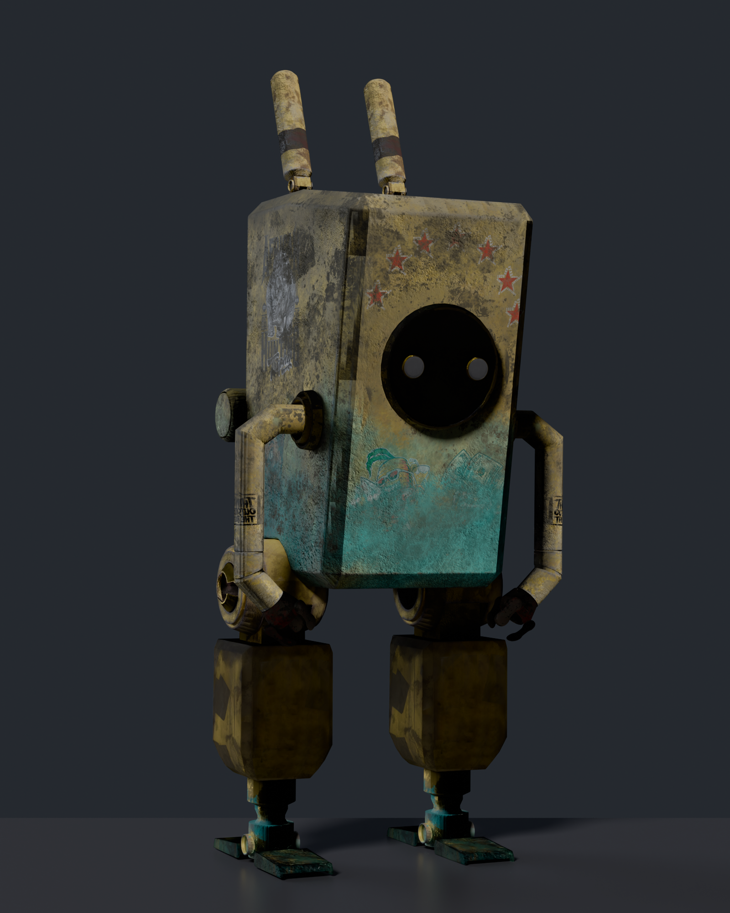

**▶ [360° 转盘演示](assets/video/robot_a2_turntable.mp4)** · 5 秒 / 720 × 900 / 0.9 MB

<p align="center">
  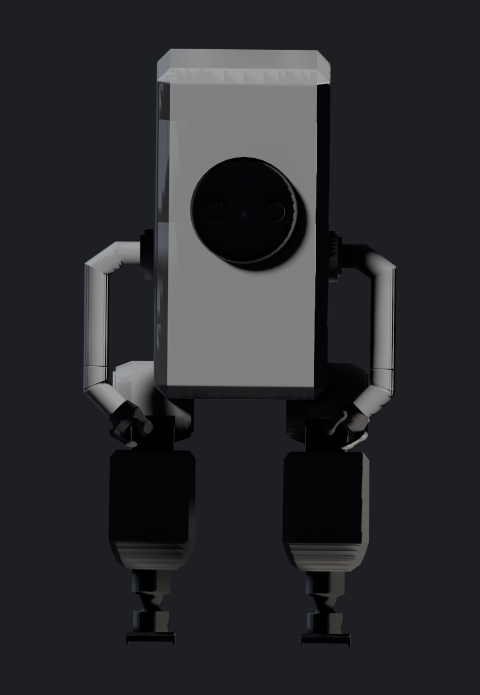
  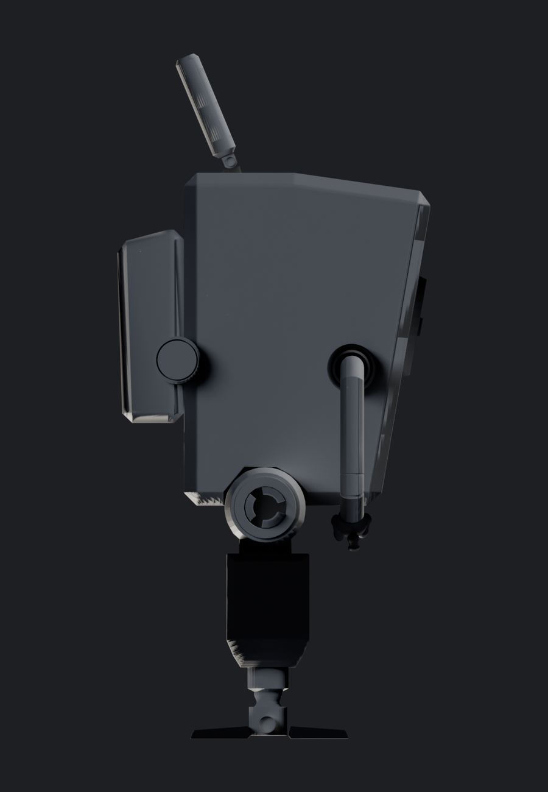
  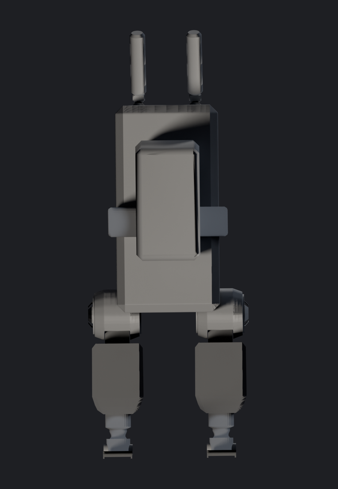
</p>

---

## 一、项目概览

| 项目 | 内容 |
| --- | --- |
| 资产类型 | 硬表面机器人角色（Game-Ready，单套贴图集） |
| 制作周期 | 2026.06.15 – 2026.06.18（4 天集训，跑完全流程） |
| 工具链 | 3ds Max 2022 · RizomUV VS RS 2022.0 · Adobe Substance 3D Painter |
| 最终网格 | 63,612 verts / 126,748 tris / 40 个部件合并为单一 Mesh |
| 真实比例 | 152.5 × 144.8 × 333.9 cm（约 3.3 m 高的巡检机器人） |
| UV 布局 | 1 个 UV Set · 333 个 UV 岛 · 空间利用率 **82.4%** |
| 贴图 | 单套 **4K PBR**：BaseColor / Roughness / Metallic / Normal |
| 展示渲染 | Blender 5.0 · Cycles · PBR 材质直渲 + Clay 对照 |
| 展示视频 | 360° 转盘 · 5 s / 24 fps / 720 × 900（0.9 MB） |

**这个项目想证明三件事：**

1. **能跑完全流程** —— 建模 → 卡线 → UV → 展 UV → 材质 → 优化 → 导出，每一环都有可交付文件。
2. **UV 效率达标** —— 333 个岛压在单张 0–1 空间内，利用率 82.4%，不是「能展开就行」。
3. **资产可用** —— 4K PBR 贴图 + OBJ/FBX 双格式，单位统一为厘米，单一 Mesh + 单一材质槽，可直接进引擎。

---

## 二、全流程拆解

```
① 硬表面建模            ② UV 展开               ③ 贴图制作             ④ 优化与导出
3ds Max 2022      →   RizomUV VS RS 2022.0  →  Substance Painter  →   3ds Max
blockout + 倒角卡线      切割 + 展平 + 打包        颜色分区 + 细节 + 接缝     减面 + 导出
     ↓                     ↓                       ↓                    ↓
 .max 工程             UV 岛排列                .spp 工程              .obj / .fbx
```

### ① 硬表面建模 — 3ds Max 2022

从大形体（Blockout）起手，身体舱体、天线、手臂、腿部、脸部拆成独立部件分别建，最后统一收进一个 Mesh。

- **大形体优先**：先定 3.3 m 的体块比例，再切结构。剪影是「方舱 + 细肢 + 双天线」。
- **倒角（Chamfer）驱动细节**：硬表面不看布线密度，看**边缘有没有为高光留过渡带**。所有可见边做 1–2 段倒角，光打上去才有金属锐边高光，而不是纸片感。
- **卡线（Support Loop）**：倒角两侧加支撑线，防止细分/平滑后边缘塌成圆角。
- **部件化建模**：40 个独立部件（Box / Cylinder 起手），降低单点修改成本。

产物：`机器人.max`（16.3 MB）。

### ② UV 展开 — RizomUV VS RS 2022.0

3ds Max 只负责导出选中模型，**切割、展开、打包全部在 RizomUV 完成**。

- **接缝位置**：优先藏在结构分件线、内凹槽、背面，正面大平面不切断。
- **按材质分区切岛**：同色/同材质零件归到同一 UV 区域，方便 Painter 整片填充。
- **自动展平 + 手动修正**：Auto Seams / Unfold 起草，再用棋盘格贴图检查拉伸（横竖格子必须等宽）。
- **打包**：单张 0–1 UV，利用率 82.4%，剩余空间留给贴纸与细节。
- **导出回 Painter**：RizomUV 直接导出带 UV 的 OBJ。

产物：`jiqiren-uv.obj` / `.mtl`（已展开 UV 的模型）。

### ③ 贴图制作 — Substance 3D Painter

- **颜色分区先行**：用填充层（Fill Layer）+ 遮罩把整机拆成「主装甲 / 副装甲 / 关节金属 / 橡胶件 / 发光件」，先定大色块关系，再进细节。
- **细节层**：脏迹、划痕、金属磨损按「边缘磨损 + 凹陷积灰」的物理逻辑叠加，而不是全屏撒噪点。
- **接缝处理**：跨 UV 岛绘制对齐，避免出现明显色差线。
- **贴纸与标识**：外部 PNG 贴花（decal）图层，贴纸边缘做磨损和褪色，让「二手设备」的叙事成立。

产物：`jiqiren-a-2.spp`（168 MB，含完整图层栈）→ 导出 4K PBR 四件套。

### ④ 优化与导出

- **减面与合并**：最终交付用 `jiqiren-MoXingYouHua.obj`（63,612 verts / 126,748 tris）。
- **统一单位**：导出时确认单位为厘米，避免进引擎后模型缩成蚂蚁或撑满关卡。
- **格式分发**：OBJ（通用交换，带 MTL）+ FBX（引擎友好）。

---

## 三、技术展示

### 成品材质渲染

PBR 贴图直渲，非后期修图。军绿底漆 + 青绿二次涂装 + 边缘锈蚀 + 贴纸褪色。

<p align="center">
  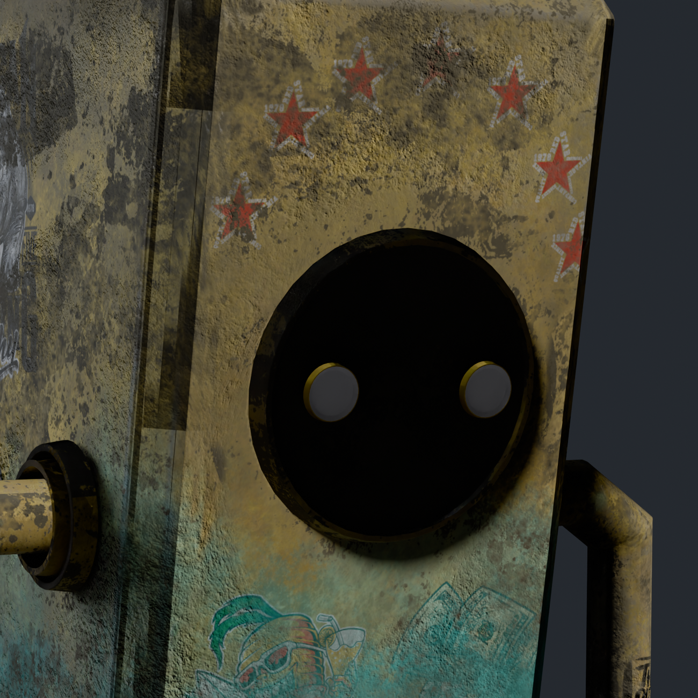
  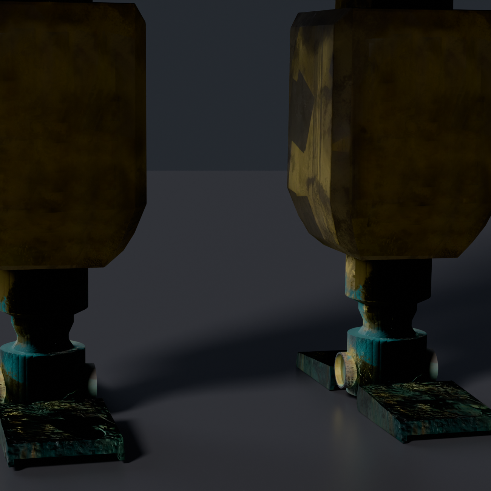
  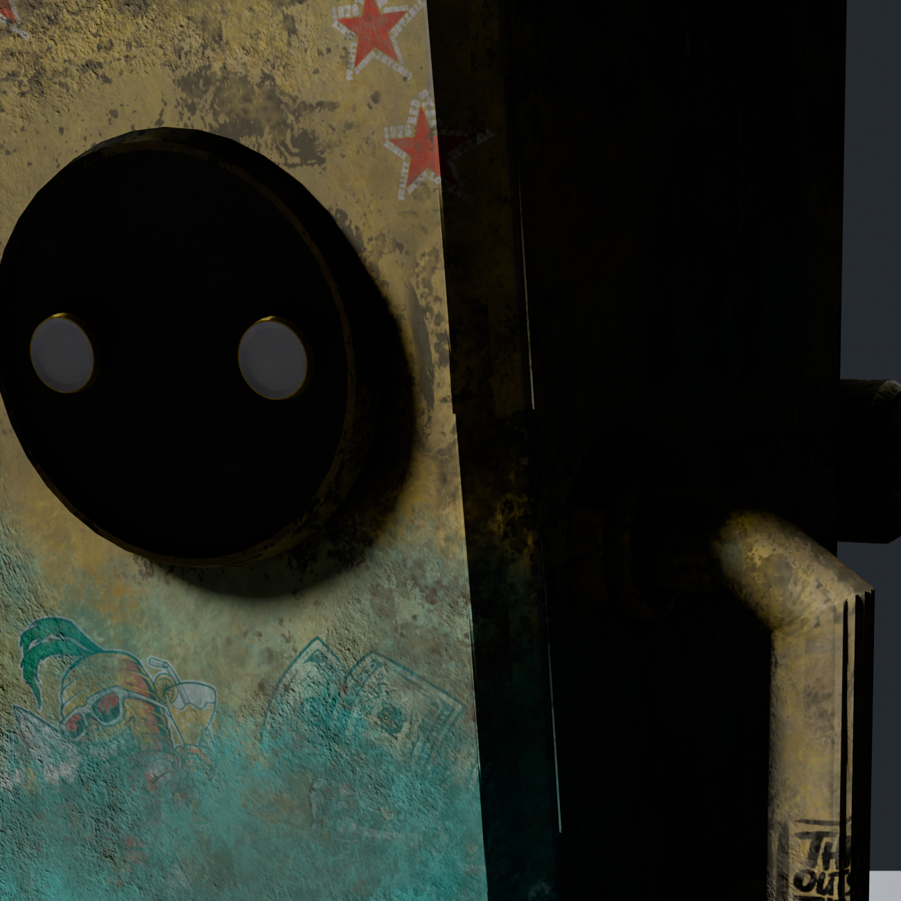
</p>

细节看三处：**脸部圆盘**（黑色面板做旧 + 白色眼睛 + 星星贴纸）、**脚踝关节**（青色涂装磨损到露出金属）、**肩臂**（管线接头与螺栓的脏迹堆积）。

### 正面全身

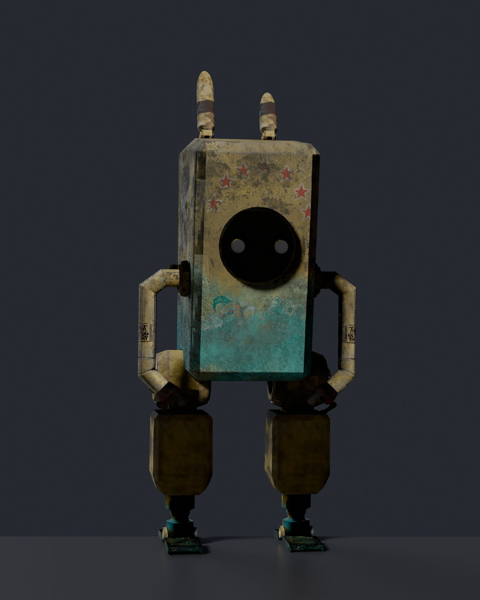

### 线框与拓扑

<p align="center">
  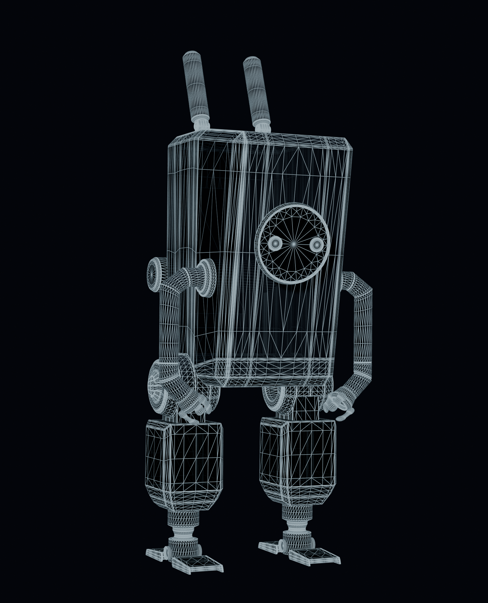
  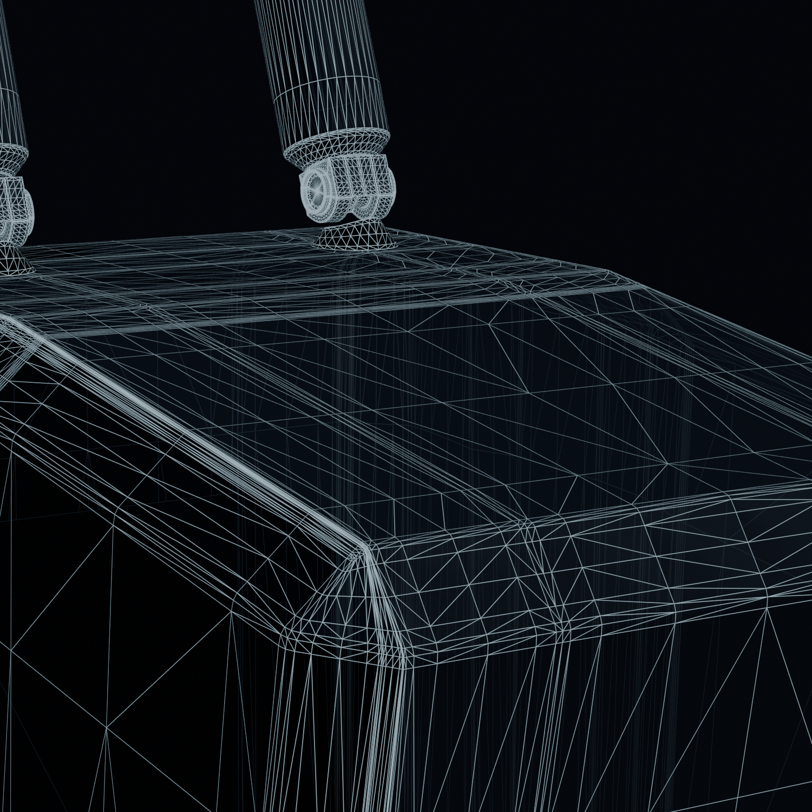
</p>

硬表面的拓扑评判标准不是「四边面占比」，而是：**倒角吃不吃得住光、曲面是否均匀、有没有给后期减面留结构**。模型在面部与关节处保留较密循环线，平面区域刻意放疏。

### UV 布局

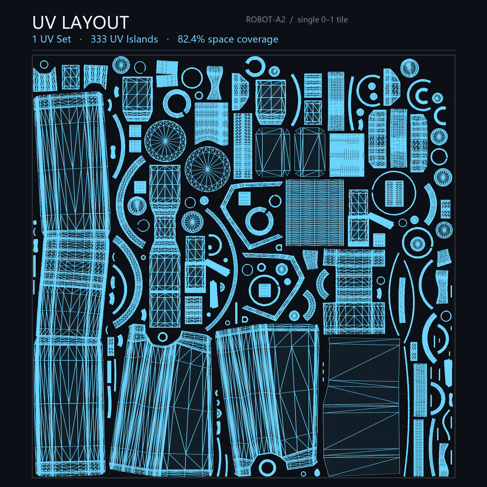

333 个 UV 岛，单套贴图，0–1 空间利用率 82.4%。大平面（舱体侧板、腿部护板）走大面积直排，小零件（螺栓、卡箍、细管）塞进缝隙。

### 贴图集

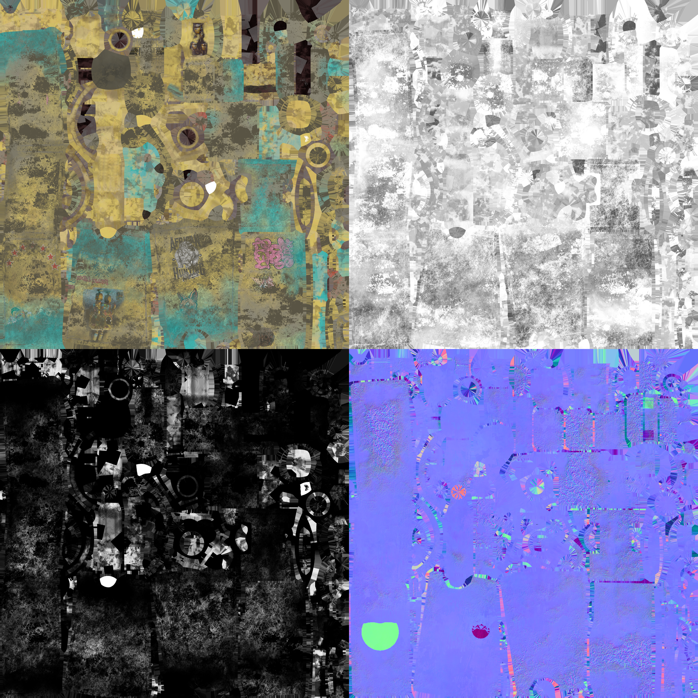

4K PBR 四件套，来自 Painter 的 `PBR Metallic Roughness` 输出模板。Roughness 均值 0.81（整体哑光），Metallic 均值 0.13（只有关节/管线是金属）—— 这两个数字决定了渲染观感，不是随手拉的滑块。

### Clay 对照

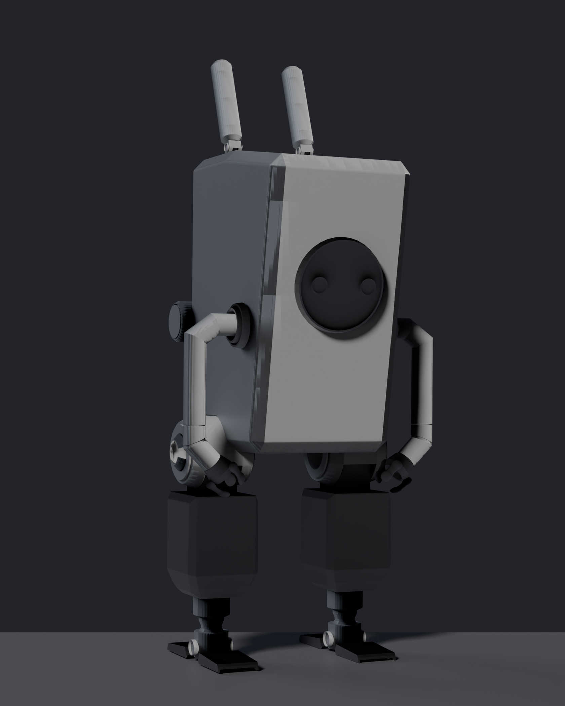

去掉贴图后的白模，用来检查形体与倒角本身是否成立。贴图救不了造型问题，Clay 能。

### 360° 转盘

**▶ [robot_a2_turntable.mp4](assets/video/robot_a2_turntable.mp4)** — 5 秒 / 24 fps / 720 × 900 / 0.9 MB

相机绕 Z 轴均匀转一圈 120 帧，没有任何面被藏起来。正面圆脸、侧面管线、背面贴纸在同一个镜头里连续出现，比九宫格图更能看出资产是否「各个角度都成立」。

---

## 四、仓库结构

```
hardsurface-robot-portfolio/
├── README.md                     ← 展示页（本文件）
├── LICENSE                       ← CC BY-NC 4.0（模型/渲染/文档分列）
├── .gitignore                    ← 排除工程缓存与大文件（video 例外放行）
├── .gitattributes                ← Git LFS 规则（默认不启用）
├── assets/
│   ├── models/                   ← OBJ + MTL + FBX ×2
│   ├── textures/                 ← 4K PBR 四件套（约 55 MB）
│   ├── video/                    ← 360° 转盘 mp4（0.9 MB）
│   └── source/                   ← .spp 托管策略
├── docs/
│   ├── 01-pipeline.md            ← 全流程与各阶段产出
│   ├── 02-modeling-notes.md      ← 硬表面建模与卡线要点
│   ├── 03-uv-notes.md            ← RizomUV 展开策略与检验方法
│   ├── 04-texturing-notes.md     ← Painter 图层逻辑与导出参数
│   ├── 05-publishing-guide.md    ← GitHub 发布规范（体积/命名/LFS）
│   └── 06-asset-checklist.md     ← 交付前自检清单
├── renders/                      ← 13 张展示图
└── reference/
    └── README.md                 ← 参考资料来源与版权声明（不存原图）
```

---

## 五、文件说明

| 文件 | 大小 | 是否入库 | 说明 |
| --- | --- | --- | --- |
| `assets/models/robot_a2_hardsurface.obj` | 12 MB | ✅ | 最终模型，含 UV |
| `assets/models/robot_a2_hardsurface.fbx` | 8.7 MB | ✅ | 引擎友好格式 |
| `assets/models/robot_a2_submitted.fbx` | 3.9 MB | ✅ | 课程提交版本，交付凭证 |
| `assets/textures/robot_a2_*.png` | ≈ 55 MB | ✅ | 4K PBR 四件套 |
| `assets/video/robot_a2_turntable.mp4` | 0.9 MB | ✅ | 360° 转盘，H.264 / yuv420p / faststart |
| `jiqiren-a-2.spp` | 168 MB | ❌ | 超单文件 100 MB 限制，见 `assets/source/README.md` |
| `机器人.max` | 16.3 MB | ⚠️ 可选 | 含未展开版本 |
| 教学视频（15 个 mp4） | ≈ 5.6 GB | ❌ | 课程资料，非作品内容 |
| 第三方贴花素材 | ≈ 25 MB | ❌ | 版权归素材站，已烘焙进 BaseColor |

---

## 六、后续可补

| 项目 | 说明 |
| --- | --- |
| LOD | 目前单一精度，进引擎靠自动减面。补 LOD1/LOD2 各一版 |
| 高度/置换 | Painter 的 Height 通道为空（全白），如需表面凹凸需重画 |
| 绑定 | 静态资产，无骨骼。要动画需重做关节布线 |

---

## 七、许可

- **模型资产**（`assets/`）：CC BY-NC 4.0 —— 可学习、可演示，禁止商用。
- **展示图与文档**（`renders/`、`docs/`）：CC BY-NC 4.0，转载请署名。
- 第三方贴花素材版权归原作者/素材站所有，**不在本仓库分发**。

详见 `LICENSE`。

---

## 八、关于

河南 · 计算机网络技术（可视化技术方向）在读，方向为 3D 硬表面 / 游戏资产。

```
制作：2026.06.15 – 06.18
贴图：Substance 3D Painter · 4K PBR
展示渲染：Blender 5.0 / Cycles
```
